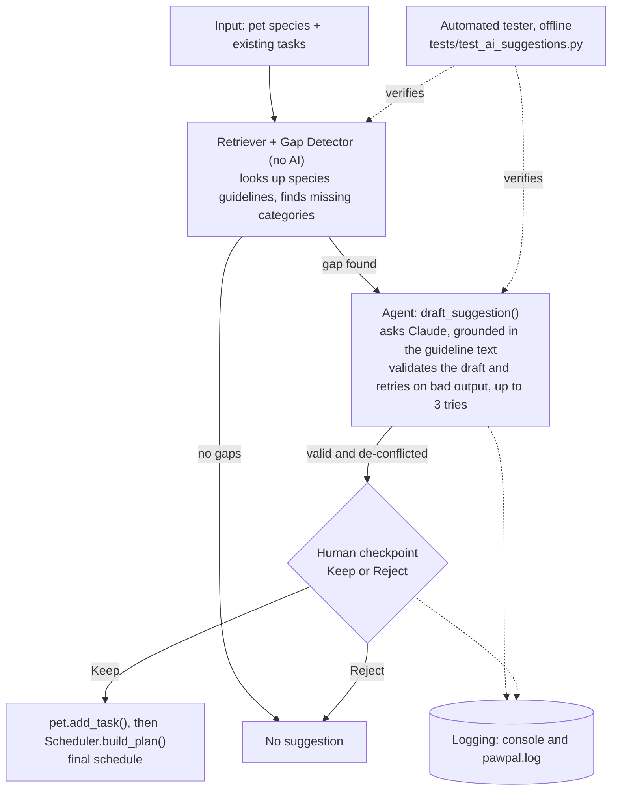
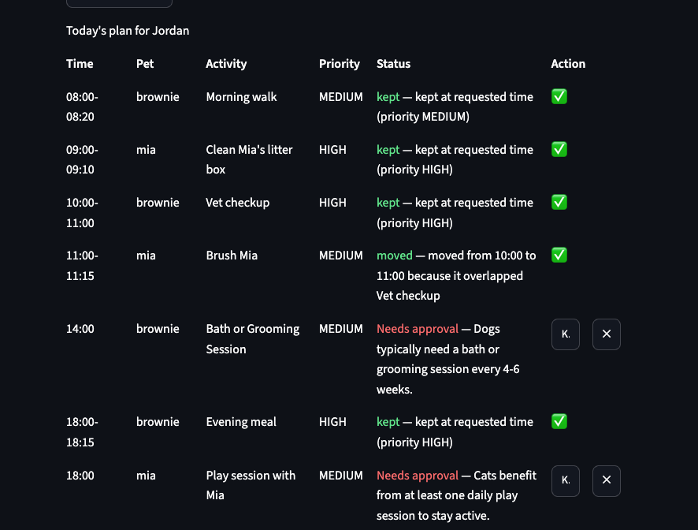
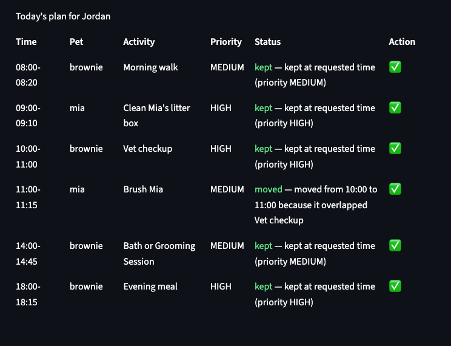

# PawPal+ — AI-Assisted Pet Care Scheduler

*A rule-based pet-care planner with a grounded AI layer on top: it proactively notices what care you forgot to schedule, drafts it, and never adds anything without a human clicking approve.*

## Original Project

This project began as **PawPal+**, built in Module 2 of this AI110 course sequence — a fully rule-based pet-care planner with no AI at all, covered by 41 automated tests. It could:

- Track any number of pets and their recurring care tasks (walks, feeding, meds, grooming)
- Build a priority-ordered daily plan that respects the owner's available time window
- Resolve time conflicts automatically and explain every decision in plain English

This capstone extends that same system with one AI feature layered on top, without changing how the original scheduler works.

## Summary

PawPal+ plans daily pet care: enter tasks (walks, feedings, vet visits, grooming) and it builds a priority-ordered schedule that resolves conflicts and explains every decision. An AI layer on top notices what's *missing* — comparing each pet's tasks against species care guidelines — and drafts the gap for a human to approve or reject.

It matters because owners need help remembering what they forgot, not an AI quietly rewriting their calendar. Every suggestion is grounded in a real guideline, validated before it's shown, and never added without an explicit click.

## Architecture Overview

The system has two halves that meet at exactly one boundary: a pure, dependency-free deterministic core (`pawpal_system.py`) and an AI layer (`care_ai.py`) that only ever *proposes* a `Task` — it can never create one directly.



Reading it left to right:

- **Retriever + Gap Detector** (no AI) looks up species care guidelines and finds what's missing — fully deterministic and unit-tested.
- **Agent** asks Claude to draft a task grounded in the guideline's exact text, validates it by constructing a real `Task` (reusing the app's own validation as its "evaluator"), and retries with the error fed back, up to 3 times.
- **De-conflict** spreads apart any suggestions that land on the same time.
- **Human checkpoint** — the owner must explicitly Keep or Reject; only Keep commits it to the real schedule.
- **Tester** (offline, fake client) and **logging** run alongside every step, off to the side of the live data flow rather than part of it.

Full diagram source: [`diagrams/architecture.mmd`](diagrams/architecture.mmd). Class-level UML for the deterministic core: [`diagrams/uml.mmd`](diagrams/uml.mmd).

## Setup Instructions

Requires Python 3.10+.

```bash
python -m venv .venv
source .venv/bin/activate  # Windows: .venv\Scripts\activate
pip install -r requirements.txt
```

That's the whole setup for the core scheduler, the Streamlit UI, and the CLI demo — `python main.py`, `streamlit run app.py` and `python -m pytest` all work at this point with no further configuration.

**Optional: enable AI suggestions.** The AI feature calls the Anthropic API and needs its own key:

1. Create a key at [console.anthropic.com](https://console.anthropic.com).
2. Set it as an environment variable in the same shell you'll run the app from:
   ```bash
   export ANTHROPIC_API_KEY="sk-ant-..."   # Windows: set ANTHROPIC_API_KEY=sk-ant-...
   ```
   This is a real shell variable, not a `.env` file — the app doesn't read `.env` files. Add the `export` line to your shell profile (e.g. `~/.zshrc`) if you don't want to retype it every session.
3. Run `streamlit run app.py` from that same shell. (If you change the key or edit the code, fully stop the server with `Ctrl+C` and start it again — Streamlit reruns the script on every interaction but doesn't reload a process that's already running.)

Without a key, the app runs exactly the same — every non-AI feature works, and "Generate schedule" shows a one-line caption explaining that AI suggestions are off instead of erroring.

**Running the test suite:**

```bash
python -m pytest
```

No API key or network access is needed — all 51 tests, including the 8 AI ones, run offline.

## Sample Interactions

*Reproducible execution evidence, text-based and gradable without a video: sample command executions are in Setup Instructions above; example input, example outputs, and reliability/guardrail results are all below and in Testing Summary.*

These are real, unedited captures from a live run with two pets: **Brownie** (dog, started with one task, "Morning walk") and **Mia** (cat, started with no tasks).

**Example input** (entered into the Streamlit form):

```
Owner: Jordan, window 07:00-20:00
Pet 1: Brownie, species=dog
  Task: "Morning walk", start=08:00, duration=20min, priority=MEDIUM, frequency=once
Pet 2: Mia, species=cat
  (no tasks)
Action: click "Generate schedule"
```

**1. Drafting.** Clicking "Generate schedule" produced 7 AI suggestions across the two pets — one per missing care category. A few of them:

| Pet | Drafted activity | Time | Priority | Reason shown |
|-----|-------------------|------|----------|----------------|
| Brownie | Evening meal | 18:00 | HIGH | "Dogs are typically fed two meals a day, morning and evening, and Brownie currently has no evening feeding task scheduled." |
| Mia | Clean Mia's litter box | 08:00 | HIGH | "A cat's litter box should be cleaned at least once a day." |
| Mia | Play session with Mia | 19:00 | MEDIUM | "Cats benefit from at least one daily play session to stay active." |
| Brownie | Bath or Grooming Session | 14:00 | MEDIUM | "Dogs typically need a bath or grooming session every 4-6 weeks, so a weekly task reminder ensures Brownie receives this care on schedule." |

**2. De-conflicting, caught live in the log.** Each category is drafted independently, so two of Mia's own suggestions — "Annual vet checkup for Mia" and "Brush Mia" — both independently landed on 10:00. The de-conflict pass caught it in the same second, before anything was ever shown:

```
2026-11-05 14:00:11,839 INFO     care_ai: care_ai: drafted 'Annual vet checkup for Mia' for mia/vet_checkup at 10:00:00 (attempt 1/3)
2026-11-05 14:00:12,890 INFO     care_ai: care_ai: drafted 'Brush Mia' for mia/grooming at 10:00:00 (attempt 1/3)
2026-11-05 14:00:12,890 INFO     care_ai: care_ai: nudged suggestion 'Brush Mia' for mia from 10:00:00 to 11:00:00 to avoid a collision
```

**3. Approving and rejecting.** The real `pawpal.log` from that same session, unedited:

```
2026-11-05 14:00:38,178 INFO __main__: Approved AI suggestion 'Clean Mia's litter box' (litter) for mia
2026-11-05 14:00:41,249 INFO __main__: Dismissed AI suggestion category 'vet_checkup' for brownie
2026-11-05 14:00:42,530 INFO __main__: Approved AI suggestion 'Annual vet checkup for Mia' (vet_checkup) for mia
2026-11-05 14:00:43,496 INFO __main__: Dismissed AI suggestion category 'grooming' for mia
2026-11-05 14:00:44,514 INFO __main__: Approved AI suggestion 'Bath or Grooming Session' (grooming) for brownie
2026-11-05 14:00:46,333 INFO __main__: Approved AI suggestion 'Evening meal' (feeding) for brownie
2026-11-05 14:00:47,566 INFO __main__: Approved AI suggestion 'Play session with Mia' (play) for mia
```

Brownie's own "Vet Checkup" was dismissed while Mia's "Annual vet checkup" was approved — a real, deliberate human decision the system simply recorded, not something it second-guessed.


*After several Keep/Reject clicks: approved suggestions turn into green confirmed rows immediately, no need to click "Generate schedule" again.*

**4. The scheduler still resolves conflicts on approved AI tasks exactly like manual ones.** In an earlier run, an approved AI-drafted grooming task collided on the owner's single shared timeline with another approved task and was automatically moved, with the same plain-English reasoning the deterministic scheduler has always given manually-entered tasks:


*"moved — moved from 10:00 to 11:00 because it overlapped Vet checkup." An AI-drafted task gets no special treatment once it's approved — it's just a `Task`, subject to the same scheduler as everything else.*

## Design Decisions

- **Deterministic gap-detection, AI only for drafting.** Keyword matching never touches the model, so it's fully testable and never flaky. Only the generative part — a concrete time, duration, and reason — uses the LLM, where it's actually useful.
- **Reusing `Task.__post_init__` as the agent's validator**, not a separate schema layer. This guarantees an AI-drafted task is checked exactly like a manually-typed one, with no second validation path to maintain.
- **Bounded retry (3x), then give up quietly — never crash.** A failed draft just leaves the gap unsuggested instead of blocking the user.
- **Human approval is mandatory; nothing auto-commits.** Every suggestion needs an explicit Keep click and goes through the same `pet.add_task(...)` path (and guardrails) as a manual task.
- **Claude Haiku 4.5, not a larger model.** Drafting one short JSON object per gap doesn't need a bigger model, and staying cheap matters since one click can fire off several drafts.
- **In-memory state only, no database.** Data is lost on restart, but it kept scope on the scheduling/AI logic rather than a persistence layer.
- **Local file logging, not a hosted service.** `pawpal.log` plus console output gives a real audit trail without needless infrastructure.

## Testing Summary

This project proves reliability three ways rather than just asserting it: **automated tests** (below), **logging and error handling** (every AI action and every guardrail rejection is recorded — see [Logging & Guardrails](#logging--guardrails)), and **human evaluation of real output** (structured table below, not screenshots).

**51 automated tests, all offline** — 43 core (`tests/test_pawpal.py`, the deterministic scheduler) + 8 AI (`tests/test_ai_suggestions.py`, using a fake LLM client, no network or API key needed):

```
collected 51 items
tests/test_ai_suggestions.py ........                                    [ 15%]
tests/test_pawpal.py ...........................................         [100%]
============================== 51 passed in 0.04s ==============================
```

**Human evaluation of real AI output.** Beyond the automated suite, every row below is a manually reviewed result from an actual live run against the real Anthropic API (not simulated), cross-checked against `pawpal.log` — reliability proof that doesn't require watching a demo to verify:

| Test input | Evaluation criteria | Result |
|---|---|---|
| Brownie (dog) with only "Morning walk" scheduled | Drafted suggestion is grounded in the real guideline text and addresses an actual missing category | **Pass** — drafted "Evening meal" (HIGH, 18:00), reason cites the real two-meals-a-day guideline fact and specifically notes Brownie has no evening feeding task |
| Mia (cat) with zero tasks | One suggestion per missing category, none omitted or duplicated | **Pass** — 4/4 cat categories (litter, play, vet_checkup, grooming) drafted; confirmed in `pawpal.log` ("4 new gap(s) for mia: [...]") |
| Two of Mia's own suggestions (vet_checkup, grooming) independently guessed the same start time, 10:00 | De-conflict pass must separate same-pet collisions before they're ever shown to a human | **Pass** — "Brush Mia" nudged from 10:00 to 11:00, logged by `care_ai` in the same second it was drafted |
| Live call to the real Anthropic API with an SDK-version mismatch (`temperature` param unsupported by the installed SDK) | App must degrade safely, never crash the page | **Fail** (first run) — uncaught `BadRequestError` crashed the page. **Pass** after broadening the retry loop's exception handling and re-testing live |
| Human reviewer disagreed with a valid, grounded suggestion ("Annual vet checkup for Mia" in one run; "Vet Checkup" for Brownie in another) | Reject must be respected and never re-suggested again that session | **Pass** — confirmed via `dismissed_gaps` and observed in `pawpal.log` ("Dismissed AI suggestion category...") |
| Pet with an unrecognized species (`"iguana"`) | Falls back to the generic guideline set instead of erroring | **Pass** — `tests/test_ai_suggestions.py::test_unknown_species_uses_default_guidelines` |

**What worked:** each scheduling rule has its own test, and I confirmed those tests actually catch regressions by deliberately breaking the code (reversed priority order, a missing drop, an off-by-one window) and watching the right test fail. Reusing `Task`'s own validation inside the AI agent meant the "is this draft valid" check came for free and stays in sync with the rest of the app by construction, rather than as a second thing to maintain.

**What didn't work at first** — both caught through actually running the app, not by unit tests, which is itself a finding worth recording:

- Each care category is drafted via an independent model call with no visibility into the others, so several suggestions for the same pet could land on the identical guessed time. Caught by reviewing real output, fixed with a deterministic de-conflict pass, and locked in with a dedicated test (`test_generate_suggestions_spreads_out_colliding_draft_times`).
- `Scheduler.build_plan`'s "moved" reason only ever named the *first* task a move collided with, which quietly understated the real reason once a task had to jump past more than one earlier task to find a free slot. Invisible in the original, sparse demo data — it only surfaced once a denser, more realistic schedule (like the one in Sample Interactions above) was reviewed by hand.

**What I learned:** fake-client tests prove the *logic* is right, but only a real run catches a mismatch with the actual SDK's API shape. And human review caught a bug schema validation never would have — each suggestion was valid alone, and only looked wrong together.

## Reflection

Adding AI to a working system clarified something: the hard part isn't getting a model to respond, it's deciding how much to trust that response and limiting the damage if it's wrong. Reusing `Task`'s own validation as the AI's check, and requiring a human click before anything becomes real, both came from that same instinct — let the AI generate ideas, never let it have the last word.

*This is a short, portfolio-style note. The graded responsible-AI reflection — how I collaborated with AI while building this, one suggestion I accepted and one I rejected or revised, and this system's limitations — is in [`model_card.md`](model_card.md).*

## Portfolio Artifact

**Code:** [github.com/HaKh27/applied-ai-system-project](https://github.com/HaKh27/applied-ai-system-project)

**What this project says about me as an AI engineer:** I treat AI as a fast drafter to review and correct, not a black box to trust by default — every AI-generated suggestion in this system goes through the same validation a human-typed task would, and nothing becomes real without an explicit human click. I held Claude Code's own claims to that same standard during development, catching a moment where its "verified, no bug" turned out to be checking an invented scenario instead of the real one. I'd rather ship something smaller and fully understood than something impressive I can't explain.

---

## Features

- **Multi-pet care tracking.** One owner, any number of pets (dog, cat, or any species you type in), each with its own tasks. Pet names must be unique.
- **Task management.** Add, edit and remove tasks with a start time, duration, priority (low, medium, high) and frequency (once, daily, weekly). Invalid input (such as a task that runs past midnight) is rejected with a clear message, and a bad edit leaves the task unchanged.
- **Sorting by time.** Tasks are listed in start-time order, with creation order breaking ties so the result is always the same (`sort_by_time`).
- **Filtering.** Show one pet's tasks, only pending or only done tasks, or both filters together (`filter_tasks`).
- **Conflict warnings.** Overlapping tasks, on the same pet or across pets, produce a readable warning instead of an error. Tasks that only touch end-to-end don't count, and completed tasks and tasks on other days are ignored (`find_conflicts`).
- **Daily and weekly recurrence.** Completing a recurring task automatically adds the next one, using calendar-safe date math for month ends and leap days. Completing it twice never creates a duplicate (`complete_task`, `next_occurrence`).
- **Priority-based daily plan.** High-priority tasks claim their slots first. A task that overlaps one already placed moves to the next free slot, and a task that can't fit is dropped (`build_plan`).
- **Available-window awareness.** Tasks outside the owner's daily window are dropped from the plan.
- **Explained decisions.** Every plan entry is marked kept, moved or dropped with a plain-English reason.
- **AI care-gap suggestions.** Clicking "Generate schedule" also compares each pet's tasks against a species care-guideline knowledge base and drafts missing ones via Claude, shown as rows you Keep or Reject. Fully optional: the app works the same without an API key, just without this feature.
- **Duplicate-task guardrail.** `Pet.add_task` rejects an exact duplicate (same name, time and day) whether it came from the manual form or an approved AI suggestion, while still allowing a second task of the same kind at a different time (e.g. two walks a day).
- **Logging.** Every add/edit/remove/complete, schedule generation, and AI suggestion drafted/approved/rejected is logged to the console and to `pawpal.log`.

## Implementation Summary

The system lives in `pawpal_system.py` and is built from four main classes, with a few small helper types. The UML is in `diagrams/uml.mmd`.

- **`Owner`** holds the owner's name, their daily available window (start and end time) and their pets. `set_window()` changes the window and rejects an end that isn't after the start. `get_all_tasks()` returns every pet's tasks together as `(pet, task)` pairs.
- **`Pet`** holds a name, a species and a list of tasks, with `add_task`, `edit_task` and `remove_task`. `edit_task` only allows the editable fields and validates the new values first, so a bad edit leaves the task unchanged. `add_task` rejects an exact duplicate (same name, time and day).
- **`Task`** is one activity: a name, a fixed start time, a duration, a priority (`LOW`, `MEDIUM` or `HIGH`, default `MEDIUM`), a frequency (`ONCE`, `DAILY` or `WEEKLY`), a due date and a completed flag. `next_occurrence()` builds the next copy of a recurring task. It computes its own end time and checks whether it overlaps another task.
- **`Scheduler`** is the brain — it reads tasks only through `Owner.get_all_tasks()`, so it plans across all pets on one shared timeline, by priority then time then creation order. An overlapping lower-priority task is moved to the next free slot or dropped; each decision is recorded as a `PlanEntry`.
- **`PlanEntry`** is one line of the plan: the task, the pet's name, its final start time, an outcome (`KEPT`, `MOVED` or `DROPPED`) and the reason, which is what lets the plan explain itself.

`pawpal_system.py` stays pure standard library (no third-party imports), so the core scheduler and its tests never depend on the network or an API key. Two small modules sit alongside it:

- **`care_ai.py`** — the AI feature: the guideline corpus, gap detection, the Claude-backed draft/validate/retry agent, and the de-conflict pass. See Architecture Overview above.
- **`logging_config.py`** — one function, `configure_logging()`, called once by both `app.py` and `main.py`.

**Status:** the classes, validation, sorting, filtering, recurring tasks, conflict detection, `build_plan()`, the `main.py` demo, the AI care-gap suggestion feature, and 51 tests (43 core + 8 AI) are done.

## Smarter Scheduling

| Feature | Method(s) | Notes |
|---------|-----------|-------|
| Task sorting | `Scheduler.sort_by_time()` | Orders `(pet, task)` pairs by start time, using task id to break ties. |
| Filtering | `Scheduler.filter_tasks()` | Filters by pet name, completion status, or both. |
| Conflict detection | `Scheduler.find_conflicts()` | Returns warning messages for overlapping tasks, never an error. |
| Recurring tasks | `Task.next_occurrence()`, `Scheduler.complete_task()` | Completing a daily or weekly task adds the next copy automatically. |
| Daily plan | `Scheduler.build_plan()` | Priority-first placement; moves or drops conflicting tasks and explains each decision. |

**Sorting.** `sort_by_time(pairs)` sorts by `(start_time, id)` so ties always resolve the same way. Returns a new list; never modifies the input.

**Filtering.** `filter_tasks(pet_name=None, completed=None)` keeps only matching `(pet, task)` pairs; a filter left as `None` is skipped, so the two can combine.

**Conflict detection.** `find_conflicts()` returns warning strings instead of raising, so the program keeps running. It checks across all pets on one shared timeline, ignoring completed, other-day, and back-to-back (non-overlapping) tasks.

**Recurring tasks.** `next_occurrence()` builds the next copy — due +1 day for `DAILY`, +7 for `WEEKLY` (from the task's own due date if later, so an early finish never double-books) — using `timedelta` so month/year/leap-day rollover is handled. `complete_task()` marks it done and adds that copy automatically; completing twice never duplicates.

**Building the plan.** `build_plan(day=today)` places pending tasks for that day by priority, then time, then creation order. A task outside the window is **dropped**; one that overlaps an already-placed task is **moved** to the next free slot or **dropped** if none fits, each with a plain-English reason. `Task` objects are never mutated, so rebuilding after an edit is always clean.

## AI Care-Gap Suggestions — implementation detail

(See Architecture Overview and Design Decisions above for the full picture; this is the function-level reference.)

| Step | Function | What it does |
|------|----------|---------------|
| Retrieve | `get_guidelines(species)` | Looks up a small curated care-guideline corpus (`CARE_GUIDELINES`) by species — walk/feeding/vet-checkup/grooming for dog and cat, a generic fallback for anything else. |
| Detect (no AI) | `detect_gaps(pet)` | Deterministically compares a pet's existing task names against its guideline categories' keywords. Fully unit-tested without any model call. |
| Draft (agentic) | `draft_suggestion(...)` | Asks Claude for one task grounded in a category's exact guideline text, validates the response by constructing a real `Task(...)`, feeds the exact error back and retries (up to 3 attempts) on failure, gives up cleanly (returns `None`, never raises) if every attempt fails. |
| De-conflict (no AI) | `_deconflict_drafts(...)` | Nudges apart any suggestions for the same pet that landed on the same guessed time, reusing `Task.overlaps` — the same rule the scheduler itself uses. |

**Without `ANTHROPIC_API_KEY` set**, the whole feature is simply off: `get_claude_client()` returns `None`, the app shows a one-line caption explaining why, and every other feature works exactly the same. `main.py`'s CLI demo never calls the model at all — it only prints `detect_gaps()`'s deterministic output, since the CLI has no approve/reject flow to act on a drafted suggestion.

## Logging & Guardrails

**Guardrails** (things the code refuses to do, rather than crashing or silently doing the wrong thing):

- Every `Task` validates itself on construction (`Task.__post_init__`): positive duration, a real `Priority`, and the task must end before midnight.
- `Pet.add_task` rejects an exact duplicate (same name, start time and day), whether it comes from the manual form or an approved AI suggestion — but still allows the same activity at a different time or on a different day.
- `Owner.add_pet` rejects a duplicate pet name; `Owner.set_window` rejects an end time that isn't after the start.
- `care_ai.draft_suggestion` never lets a bad model response reach the UI: a malformed response or a `Task` validation failure is retried with the error fed back, and if every attempt fails it returns `None` instead of raising.
- `get_claude_client()` catches any failure building the Anthropic client (missing/invalid key, network issue) and returns `None` — the rest of the app, including the deterministic scheduler, keeps working either way.
- Every Streamlit form (add/edit/remove/complete a task, add a pet, change the window, approve a suggestion) wraps its action in `try`/`except ValueError` and shows the message with `st.error(...)` instead of crashing the page.

**Logging** (`logging_config.py`, called once by both `app.py` and `main.py`): writes timestamped lines to the console and to `pawpal.log` (gitignored, a runtime artifact) — idempotent, so Streamlit's constant reruns never pile up duplicate handlers. See the real excerpt in Sample Interactions above; set `PAWPAL_LOG_LEVEL=DEBUG` to change verbosity.

## Demo Walkthrough

Start the app with `streamlit run app.py`. (For a terminal version of the deterministic core only, run `python main.py`.)

### Example workflow

1. **Enter owner and pet info.** Under "Owner and Pets", type the owner's name and add a pet, for example Rex the dog.
2. **Add tasks.** Pick the pet and add "Morning walk" (07:30, 30 min, High, daily) and "Grooming" (17:00, 45 min, Low, weekly). The task table lists them sorted by time.
3. **Filter and edit.** Use "Filter by pet" and "Filter by status" to narrow the list. Under "Edit or remove a task", choose a task and press "Save changes", "Mark complete" or "Remove task".
4. **Generate today's schedule.** Press "Generate schedule". Overlaps are listed in a warning, and the plan table shows each task's final time, priority, outcome and reason — plus, if `ANTHROPIC_API_KEY` is set, a red "Needs approval" row for each AI-detected care gap.
5. **Approve or reject.** Click Keep or ✕ on any AI suggestion. See Sample Interactions above for real captured output of this entire flow.

### Sample CLI output (`python main.py`)

```
Today's Schedule for Jordan (07:00-20:00)

Generated Plan
Time        | Pet Name | Activity       | Priority | Outcome | Reason
----------------------------------------------------------------------------------------------------
07:30-08:00 | Rex      | Morning walk   | HIGH     | kept    | kept at requested time (priority HIGH)
12:30-12:45 | Rex      | Vet call       | HIGH     | kept    | kept at requested time (priority HIGH)
12:45-13:05 | Mia      | Play session   | MEDIUM   | moved   | moved from 12:30 to 12:45 because it overlapped Vet call
17:15-17:45 | Rex      | Training       | MEDIUM   | kept    | kept at requested time (priority MEDIUM)
17:45-18:30 | Rex      | Grooming       | LOW      | moved   | moved from 17:00 to 17:45 because it overlapped Training

Dropped
06:00  Rex   Early meds     outside available window (07:00-20:00)

Care gaps (see the Streamlit app for AI-drafted suggestions)
Rex: missing feeding
Mia: missing litter, vet_checkup, grooming

Completing recurring tasks
Rex: Morning walk (daily) done -> next due 2026-11-06
Rex: Grooming (weekly) done -> next due 2026-11-12
Mia: Play session (once) done -> no next occurrence
```

`python main.py` never calls the AI model — the "Care gaps" section above is `detect_gaps()`'s plain deterministic output, with no API key required.

### Screenshots


*An early version of the schedule builder (pre-AI): a task moved to avoid a conflict.*


*A task dropped because it falls outside the owner's available window.*


*The AI suggestion workflow in progress — see Sample Interactions above for the full narrated walkthrough.*
